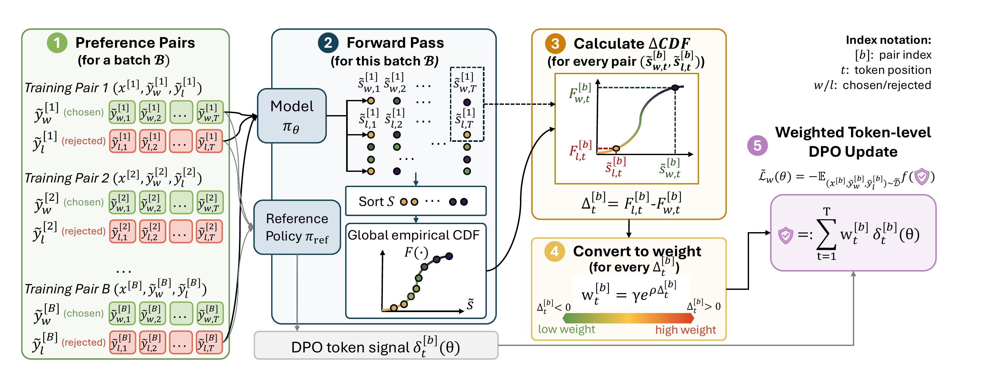

# PORT: Preference Optimization with Ranking-based Token weighting

<!-- TODO: confirm the exact paper title, then fill in authors / links below. -->

Official implementation of **PORT** (NeurIPS 2026).

<!-- [[Paper]](TODO) [[arXiv]](TODO) [[OpenReview]](TODO) -->

<p align="center">
  
</p>

## Overview

Standard DPO treats every preference pair in a batch equally. PORT instead
**reweights each pair by how hard it currently is for the policy**, using a
batch-level, rank-based (empirical CDF) signal. This makes the weight robust to
the scale of the implicit reward.

As shown in the figure above, each training step works as follows:

1. **Preference pairs.** Sample a batch $\mathcal{B}$ of pairs $(x^{[b]}, \tilde y_w^{[b]}, \tilde y_l^{[b]})$.
2. **Forward pass.** Run the policy $\pi_\theta$ and the reference policy $\pi_{\text{ref}}$ to get
   implicit-reward scores $\tilde s$ for chosen and rejected responses. Sort all scores in
   the batch and build a **global empirical CDF** $F(\cdot)$.
3. **Calculate $\Delta\mathrm{CDF}$.** For every pair, compute
   $\Delta^{[b]} = F^{[b]}_{l} - F^{[b]}_{w}$, the gap between the CDF ranks of the rejected and chosen responses.
4. **Convert to weight.** Map the gap to a weight $w^{[b]} = \gamma\, e^{\rho \Delta^{[b]}}$.
   Pairs where the rejected response is ranked above the chosen one ($\Delta > 0$) get a high
   weight. Pairs that are already well separated ($\Delta < 0$) get a low weight.
   Weights are lower-clipped at `min_weight_ratio × max_weight` and then normalized to mean 1.
5. **Weighted DPO update.** Optimize the reweighted token-level DPO objective
   $\tilde{\mathcal L}_w(\theta) = -\mathbb E\, f\big(\sum_t w_t^{[b]}\,\delta_t^{[b]}(\theta)\big)$.

The token-level DPO signal follows TDPO (sequence-level log-ratio margin plus a
per-position KL term). See `port_loss` in [`port/utils/loss.py`](port/utils/loss.py).

## Repository structure

```
.
├── figs/
│   └── whole_arch.{pdf,png}        # method overview figure
└── port/
    ├── train.py                    # Hydra entry point (SFT / PORT training)
    ├── requirements.txt
    └── utils/
        ├── loss.py                 # PORT loss, empirical CDF, forward pass, metrics
        ├── loss_factory.py         # maps cfg.loss.name -> loss function
        ├── trainers.py             # BasicTrainer / FSDPTrainer / TensorParallelTrainer
        ├── data_factory.py         # tokenization + batch iterators
        ├── spawn.py                # distributed / misc helpers
        └── dataset/                # HH-RLHF, AlpacaFarm, ... loaders
```

## Installation

```bash
conda create -n port python=3.10 -y
conda activate port
pip install -r port/requirements.txt
```

The code was developed with PyTorch ≥ 2.0 and Transformers ≥ 4.30. Multi-GPU training uses PyTorch FSDP.

## Data

| Name (`datasets=`)   | Source                                                              |
| -------------------- | ------------------------------------------------------------------- |
| `hh`                 | [Anthropic/hh-rlhf](https://huggingface.co/datasets/Anthropic/hh-rlhf) |
| `hh_pairwise_noise`  | HH-RLHF with randomly flipped pairs (`noise_rate`, `partial_ratio`)  |
| `alpaca_farm`        | AlpacaFarm human preferences (local JSON)                           |

Hugging Face datasets download automatically into `local_dirs`.

## Training

Training follows the usual two stages: SFT on the chosen responses, then PORT
starting from the SFT checkpoint. All settings are Hydra configs, so you can
override any field from the command line.

**1. SFT**

```bash
cd port
python train.py \
    model=<model_config> datasets=[hh] loss=sft \
    exp_name=hh_sft trainer=FSDPTrainer \
    batch_size=64 eval_batch_size=32 lr=5e-7
```

**2. PORT**

```bash
python train.py \
    model=<model_config> datasets=[hh] loss=port \
    model.archive=/path/to/sft/LATEST/policy.pt \
    exp_name=hh_port trainer=FSDPTrainer \
    loss.beta=0.1 loss.alpha=0.5 \
    loss.ranking_method=vbon_absolute_difference \
    loss.min_weight_ratio=0.1
```

Checkpoints, the resolved `config.yaml`, and logs go to `<local_dirs>/<exp_name>_<timestamp>/`.
Set `wandb.enabled=true wandb.entity=<entity> wandb.project=<project>` to log to Weights & Biases.

<!-- ### Key PORT hyperparameters

| Field                   | Meaning                                                                 |
| ----------------------- | ----------------------------------------------------------------------- |
| `loss.beta`             | DPO temperature β                                                      |
| `loss.alpha`            | Weight of the token-level KL term (TDPO2)                               |
| `loss.if_tdpo2`         | Use the TDPO2 (`true`) or TDPO1 (`false`) form of the token-level signal |
| `loss.ranking_method`   | How pair weights are computed (`vbon_absolute_difference`, `loss_based`) |
| `loss.min_weight_ratio` | Lower clip for weights, as a fraction of the max weight in the batch   |
| `loss.weight_power`     | Exponent on rank weights (`loss_based` only)                            |
| `loss.N`                | Virtual Best-of-N size. Defaults to the batch size if `null`.          | -->

## Citation

The BibTeX entry will be available soon.

## Acknowledgements

This codebase builds on [TIS-DPO](https://github.com/exlaw/TIS-DPO), [TDPO](https://github.com/Vance0124/Token-level-Direct-Preference-Optimization), and [DPO](https://github.com/eric-mitchell/direct-preference-optimization). We thank the authors for releasing their code.
